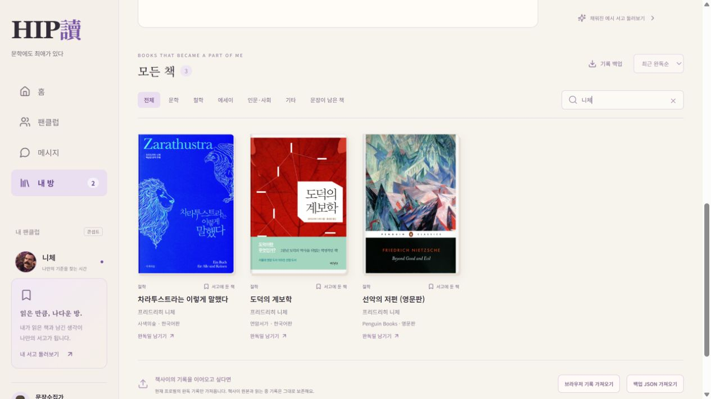

# HIP讀 · 힙독

**문학에도 최애가 있다.**

작가·철학자 팬덤과 개인 독서 공간을 결합한 성인용 웹앱입니다. 최애를 고르고, DM에 답하고, 원문을 읽고 문제를 맞혀 문장 카드를 뽑습니다. 읽은 책과 문장·감상은 내 방의 개인 서고에 모입니다.



## 바로 실행

저장소를 다운로드한 뒤 **`힙독.html`을 Chrome 또는 Edge로 열면** 실행됩니다. 앱 코드와 캐릭터·도서 표지 이미지를 파일 하나에 포함했습니다. API 키가 필요하지 않습니다.

로컬 파일의 저장 정책은 브라우저마다 다를 수 있습니다. 계속 이용할 때에는 아래 개발 서버 또는 정적 호스팅을 사용하고 중요한 기록은 JSON으로 백업해 주세요.

## 개발 환경

Node.js 20.19 이상 또는 22.12 이상을 사용합니다.

```sh
npm ci
npm run dev
```

기본 주소는 `http://127.0.0.1:5174`입니다.

```sh
npm test                  # 서고 테스트 11개 + 진행 기록 테스트 19개 (Node 22 이상)
npm run typecheck         # TypeScript 검사
npm run build             # TypeScript 검사 및 프로덕션 빌드
npm run build:standalone  # 이미지까지 포함한 힙독.html 생성
```

## 구현한 기능

- 첫 화면, 입덕(닉네임과 최애), 팬 배지, 홈, DM, 원문 읽기와 문제, 문장 카드, 팬덤 점수와 순위
- 하단(넓은 화면은 왼쪽) 메뉴: 홈, DM, 읽기, 내 방
- 입체 개인 서고, 아바타 이동, 장르별 책장
- 읽은 책 등록, 제목·저자 검색, 정렬
- 완독일·문장·감상 저장과 수정, 닉네임 설정, JSON 백업
- 실제 표지를 연결한 니체 저서 3종과 완독 등록
- 기존 책사이 백업에서 현재 프로필의 최신 완독 기록만 가져오기

니체 저서는 먼저 참고 도서로 표시합니다. 실제 완독일을 입력하기 전에는 개인 독서 기록으로 저장하거나 완독 통계에 포함하지 않습니다. 기존 기록과 같은 책을 등록하면 참고 도서를 중복 표시하지 않습니다.

## 데이터와 시연 범위

- 서고 기록은 `hipdok.library.v1`, 입덕과 진행 기록은 `hipdok:v1`에 각각 저장됩니다. 서버 로그인이나 기기 간 동기화는 없습니다.
- 닉네임: 서고 기록이 아직 없으면 입덕 닉네임을 이름표 초기값으로 씁니다. 이미 저장된 서고 이름은 덮어쓰지 않습니다. 내 방에서 이름을 바꾸면 입덕 닉네임도 같이 바뀝니다.
- 예시 서고의 9권은 개인 기록과 분리되며 자동으로 저장되지 않습니다.
- 팬덤 순위는 "예시 점수"입니다. 실시간 경쟁은 없습니다.
- DM과 인물 대사는 "제작진 각색"이며 실제 인물의 발언이 아닙니다. 콘텐츠 검수 상태는 `docs/콘텐츠-검수표.md`, 필요한 그림은 `docs/이미지-목록.md`에 있습니다.
- 도서 표지는 판본과 출처를 함께 표시합니다. [이미지 자산과 표지 출처](ASSETS.md)를 참고하세요.
- 책사이의 공간과 가구 스타일을 재사용했습니다. 원본 책사이는 이 저장소에 포함하지 않습니다.

## 구조

```
src/
  main.tsx            시작점
  app/App.tsx         화면 전환. 입덕 전에는 메뉴 없음
  components/         여러 기능이 같이 쓰는 조각(메뉴, 초상, 문장 카드, 순위)
  styles/global.css   색 값, 초기화, 메뉴. 묶이지 않는 유일한 CSS
  styles/fandom.css   입덕 쪽 화면 공통
  data/               인물, DM, 원문과 문제, 카드, 예시 순위
  store/              진행 기록(progress.ts 규칙, store.ts 저장). 키 hipdok:v1
  features/
    landing, onboarding, home, dm, reading, card
    my-room/          내 방
      MyRoomPage      화면 틀
      RoomView, Room  서고 화면과 입체 방
      LibraryDialogs, Dialog, Cover  책 등록, 상세, 이름 팝업
      useLibrary, storage, libraryData  서고 상태와 저장, 책장 정의
      myRoomData      내 방이 입덕 쪽 기록(카드, 점수, 최애)을 읽는 유일한 창구
      theme.css       앱 색에 맞춘 덮어쓰기
  library.mjs, editions.mjs, covers.ts, legacy-data.ts  서고 저장 규칙과 표지
  room.css, style.css  희경 선생님의 서고 스타일(원본 유지)
```

### CSS를 나눈 방법

서고와 입덕 쪽이 같은 클래스 이름(`.tag`, `.brand` 등)을 쓴다. 원본을 고치지 않도록 빌드 때 `scripts/scope-css.mjs`가 자동으로 묶는다.

| 파일 위치 | 묶이는 곳 |
|---|---|
| `src/room.css`, `src/style.css`, `src/features/my-room/` | `.my-room-scope` |
| `src/styles/global.css` | 묶지 않음 |
| 그 밖의 `src/` CSS | `.fandom-scope` |

새 CSS 파일은 자기 기능 폴더에 두면 된다. 입덕 쪽 조각을 내 방에 보일 때는 `<div className="fandom-scope">`로 감싼다(문장 카드가 그 예).

### 나눠 고칠 때

| 담당 | 고치는 곳 | 건드리지 않는 곳 |
|---|---|---|
| A (미션 추가) | `src/data/`, `src/features/reading/`, `src/features/card/`, `src/store/` | `src/features/my-room/` |
| B (카드 전시) | `src/features/my-room/` | `src/data/`, `src/store/`, reading, card |

- B는 카드를 `myRoomData.ts`의 `useMyRoomData()`로 읽고, 그림은 `components/QuoteCardView`를 그대로 쓴다.
- A가 진행 기록 모양을 바꿔도 `myRoomData.ts`의 함수 이름과 돌려주는 모양은 유지한다.
- `components/`, `styles/`, `app/`, `package.json`을 꼭 고쳐야 하면 상대에게 먼저 알린다.
- 서고 쪽에서 바꾸지 않는 것: `room.css`의 내용, `library.mjs`, 저장 키, 저장 형식.

기술 구성: React 19, TypeScript, Vite, Vitest, lucide-react.
