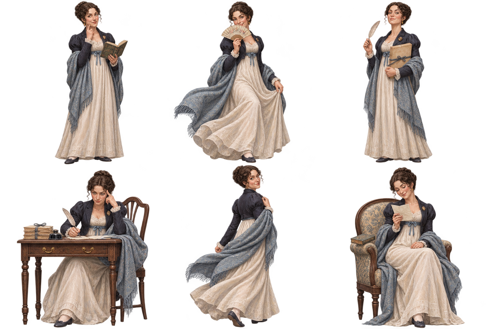

# 제인 오스틴 캐릭터 시트

- 제작일: 2026-11-07
- 이미지: `public/images/jane-austen-character-sheet.png` (1536 × 1024, 알파 채널 포함 PNG)
- 구성: 책을 들고 관찰하기, 부채 뒤에서 장난스럽게 웃기, 원고와 깃펜을 든 자신감 있는 자세, 집필에 몰입하기, 걸으며 돌아보기, 편지를 읽으며 미소 짓기의 6가지 포즈
- 디자인: 사용자가 제공한 역사 인물 캐릭터 시트의 3열 × 2행 배치와 정교한 반실사 게임 일러스트풍을 참고했다. 동일한 얼굴과 리젠시 시대풍의 아이보리 드레스, 남색 재킷, 푸른 숄을 유지했다.
- 인물 해석: 예리한 관찰력, 재치와 장난기, 작가로서의 끈기와 독립성, 가까운 사람에게 보이는 다정함을 창작적으로 표현했다. 실제 역사적 외모를 재현한 자료는 아니다.
- 생성 도구: 내장 `image_gen`
- [최종 생성 프롬프트](jane-austen-character-sheet-prompt.txt)

이 파일은 여섯 가지 포즈를 담은 캐릭터 시트 원본이다. 앱 화면의 기존 초상이나 캐릭터 이미지를 교체하지 않는다.
