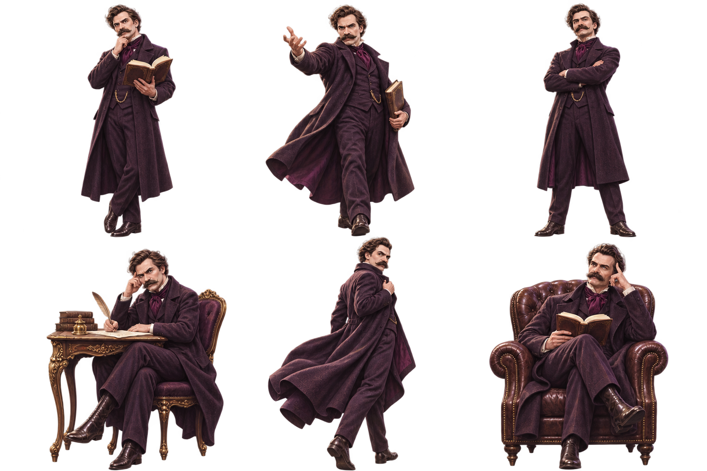

# 니체 캐릭터 시트

- 제작일: 2026-11-07
- 이미지: [니체 캐릭터 시트](../public/images/nietzsche-character-sheet.png)
- 형식: PNG, 1536 × 1024, 3열 × 2행
- 생성 도구: 내장 `image_gen`
- 참조: 사용자가 제공한 니체 캐릭터 일러스트 및 HIP讀 앱 목업
- 생성 프롬프트: [프롬프트 원문](nietzsche-character-sheet-prompt.txt)

기존 니체 디자인의 굵은 콧수염, 웨이브 머리, 짙은 보라색 코트와 크라바트를 유지한 가상 캐릭터 재해석입니다.

왼쪽 위부터 사색하며 독서, 손을 내밀며 논쟁, 팔짱을 낀 자세, 책상에서 집필, 뒤돌아보며 걷기, 안락의자에서 독서하는 여섯 동작으로 구성했습니다.

