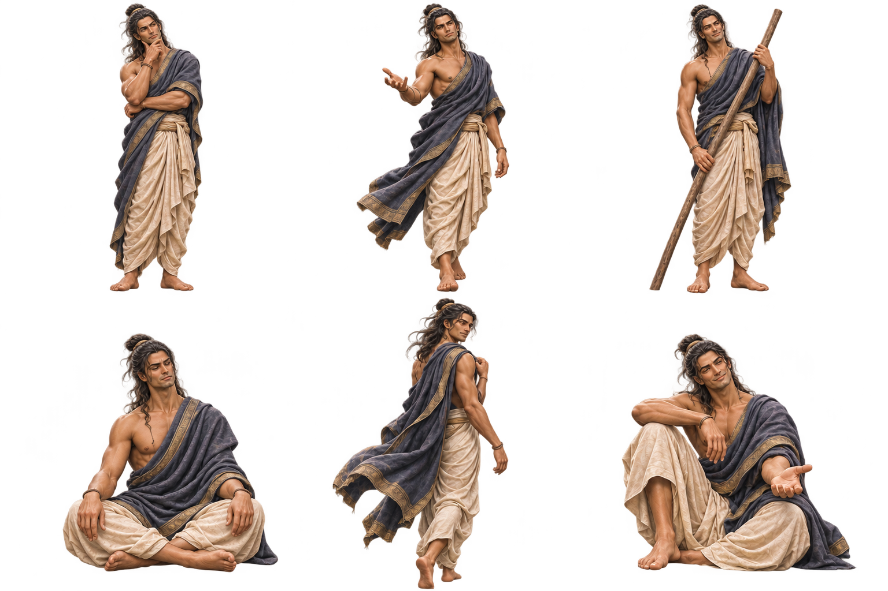

# 싯다르타 캐릭터 시트

- 제작일: 2026-11-07
- 이미지: `public/images/siddhartha-character-sheet.png` (1536 × 1024, 투명 배경 PNG)
- 구성: 턱에 손을 대고 사색하기, 손을 펼치며 앞으로 걷기, 나룻배 장대를 들고 경청하기, 가부좌로 앉아 집중하기, 걸으며 뒤돌아보기, 한쪽 무릎을 세우고 앉아 다정하게 손 내밀기의 6가지 전신 포즈
- 디자인: 사용자가 승인한 싯다르타의 얼굴, 긴 반묶음 머리, 아이보리색 하의와 금색 테두리의 남색 천을 유지했다. 기존 캐릭터 시트 양식에 맞춰 3열 × 2행으로 배치하고 제목과 얼굴 확대 컷을 제외했다.
- 인물 해석: 헤르만 헤세의 소설 『싯다르타』 주인공의 독립성, 자부심, 구도심과 경청, 다정함을 창작적으로 표현했다. 고타마 붓다의 초상이나 역사적 복식을 고증한 자료는 아니다.
- 생성 도구: 내장 `image_gen`
- 검증: PNG 알파 채널과 포즈 사이 투명 영역을 확인하고, 업로드 파일이 생성 원본과 일치하는지 SHA-256으로 확인했다.
- [최종 생성 프롬프트](siddhartha-character-sheet-prompt.txt)

여섯 가지 포즈를 담은 캐릭터 시트 원본이다. 앱 화면의 기존 이미지를 교체하지 않는다.
