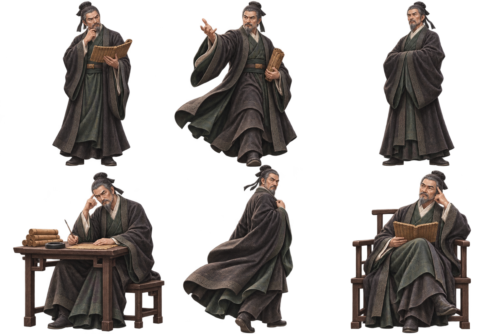

# 순자 캐릭터 시트

- 제작일: 2026-11-07
- 이미지: `public/images/xunzi-character-sheet.png` (1536 × 1024, 알파 채널 포함 PNG)
- 구성: 독서·사색, 설명, 기본 자세, 집필, 뒤돌아보기, 앉아서 경청하기의 6가지 포즈
- 디자인: 사용자가 제공한 니체 캐릭터 시트를 참고한 사실적인 인체 비율과 정교한 게임 일러스트풍. 동일한 얼굴과 복식을 유지한 순자의 창작적 재해석이다.
- 인물 해석: 사용자가 제공한 순자의 성악설·수양론 대화앱 문서를 바탕으로, 배움과 실천을 돕는 차분한 스승의 성격을 반영했다. 실제 역사적 외모를 재현한 자료는 아니다.
- 생성 도구: 내장 `image_gen`
- [최종 생성 프롬프트](xunzi-character-sheet-prompt.txt)

이 파일은 3열 × 2행의 캐릭터 시트 원본이다. 앱이 사용하는 단일 초상 `portrait-xunzi.png`와는 별도 자산이다.
